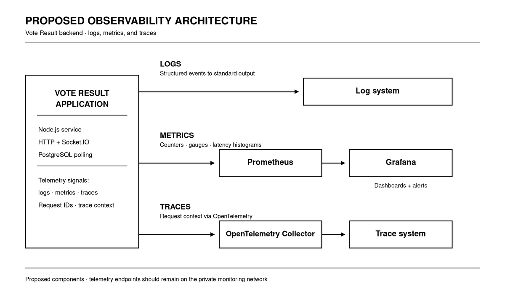

# Backend Reliability Lab — Example Voting App

This project extends the Example Voting App with PostgreSQL failure handling, automated regression tests, structured logging, liveness and readiness probes, graceful shutdown, and a digest-based rollback drill.

The aim is to answer: what fails, what the user sees, how an operator detects it, and how recovery can be verified.

## Application architecture

| Service | Responsibility | Required dependency |
| --- | --- | --- |
| Vote — Python/Flask | Accepts votes and puts them in a queue | Redis |
| Redis | Holds queued votes | Container host |
| Worker — .NET | Reads queued votes and writes them to the database | Redis and PostgreSQL |
| PostgreSQL | Stores votes | Persistent `db-data` volume |
| Result — Node.js | Queries vote totals and sends scores to browsers through Socket.IO | PostgreSQL |

Vote submission to Redis and persistence in PostgreSQL are separate steps. A successful queue write does not prove that the Worker has saved the vote.


## Prerequisites

- Docker Desktop or Docker Engine, running with Linux containers.
- Docker Compose v2. Use a version supporting `--wait`; the optional rollback override also requires support for the `!reset` YAML tag.
- Node.js and npm for the regression tests. The original recorded test run used Node.js 24.18.0; the Result image currently uses Node.js 18.
- Ports `8080` and `8081` available. The optional rollback registry uses port `5000`.
- Internet access for the first dependency installation and container build.

Run commands from the repository root, where `docker-compose.yml` is located. The commands below use Windows Command Prompt. Use `curl.exe` for HTTP checks on Windows; use `curl` on Linux or macOS.

The database credentials in Compose are for this local exercise. Configure credentials separately for a production deployment.

## One-command setup

Start and build the application:

```cmd
docker compose up -d --build --wait --wait-timeout 120
```

The first build can take several minutes. After startup, open:

| Page | URL |
| --- | --- |
| Vote submission | http://localhost:8080 |
| Live results | http://localhost:8081 |

Submit a vote before introducing a failure. Confirm that the Result page displays non-zero totals. Use a separate browser profile or private window to create another voter; changing one voter's choice does not necessarily increase the total number of votes.

Check service status and the database:

```cmd
docker compose ps -a
docker compose exec -T db psql -U postgres -d postgres -c "SELECT vote, COUNT(*) AS count FROM votes GROUP BY vote ORDER BY vote;"
```

The Worker creates the `votes` table. Basic database readiness can succeed before that table exists. If the initial Result query fails during this startup race, confirm the table exists using the command above, then run:

```cmd
docker compose restart result
```

## Automated regression tests

Install the locked test dependencies once:

```cmd
npm ci
```

Run the configured regression suite with one command:

```cmd
npm test
```

The configured suite contains nine tests across two files. It covers:

- Successful database connection and valid non-zero scores.
- Query failure and connection loss.
- The unavailable-results message and removal of old numeric scores.
- Prevention of late query results being emitted after connection loss.
- Cancellation of polling after a detected failure.
- New browser connections during an outage.
- Recovery through a fresh backend instance after the cause is corrected.

The database and network are simulated. Docker is not required for these tests. They do not prove real PostgreSQL connectivity or a complete vote-to-results journey.

### Additional health-probe tests

The current file `tests/health-probes.js` contains three tests but is excluded by the default `*.test.js` discovery rule. Run it explicitly:

```cmd
npm test -- --testMatch "**/tests/health-probes.js"
```

This checks liveness HTTP 200, successful readiness HTTP 200, and database-failure readiness HTTP 503. It does not currently test the 500 ms deadline or pool saturation.

To include these three tests in the normal suite, rename the file to `tests/health-probes.test.js`. With that rename, the existing Jest configuration will discover all twelve tests.

See [TESTING.md](docs/TESTING.md) for the test strategy, fixtures, isolation, and limitations.

## Health and version checks

```cmd
curl.exe -i http://localhost:8081/healthz
curl.exe -i http://localhost:8081/readyz
curl.exe -i http://localhost:8081/version
```

| Endpoint | Current contract |
| --- | --- |
| `/healthz` | HTTP 200 when the Node.js service can handle the request; does not check PostgreSQL. |
| `/readyz` | Runs `SELECT 1` through the pool with a 500 ms response deadline. Returns HTTP 200 on success or HTTP 503 with structured JSON on failure, timeout, or detected pool saturation. |
| `/version` | Returns service name, package version, and `GIT_SHA`; ordinary Compose builds report `unknown` unless the build argument is supplied. |

Compose checks Result readiness every 10 seconds, with a two-second healthcheck timeout, three retries, and a 15-second start period. An unhealthy container remains running; Compose does not automatically remove it from HTTP traffic or restart it.

**Readiness limitation:** a successful `SELECT 1` does not prove the application table exists or results polling is active. After a polling failure, `/readyz` can return 200 while browsers still show unavailable results. Always verify fresh scores and a controlled vote after recovery.

## Manual failure reproduction

Run one scenario at a time on this local test stack. Complete its recovery steps and confirm fresh results before starting the next scenario.

Follow application logs in a separate terminal:

```cmd
docker compose logs -f --since 10s --timestamps result worker db redis
```

### 1. PostgreSQL unavailable at Result startup

Stop Result, Worker, and PostgreSQL, then start Result without its dependencies:

```cmd
docker compose stop result worker db
docker compose up -d --no-deps result
```

Expected: Result remains running, browsers receive an unavailable state, and connection attempts are logged. `--no-deps` deliberately bypasses normal Compose startup ordering. Initial connection retries use a fixed one-second interval between failed attempts, up to 1,000 attempts; individual attempt time is additional.

Recover:

```cmd
docker compose start db
docker compose exec -T db pg_isready -U postgres -d postgres
docker compose start worker
```

Wait for `pg_isready` to report accepting connections. Result can recover through its initial connection retries if their budget has not been exhausted. If necessary, restart Result after the database and table are ready.

### 2. PostgreSQL responds slowly

Hold an exclusive table lock for 15 seconds:

```cmd
docker compose exec -T db psql -U postgres -d postgres -v ON_ERROR_STOP=1 -c "BEGIN; SET LOCAL lock_timeout = '5s'; LOCK TABLE votes IN ACCESS EXCLUSIVE MODE; SELECT pg_sleep(15); ROLLBACK;"
```

While this command runs, change a vote in the browser. Expected: Result's aggregation and Worker writes wait for the lock; previously displayed totals can remain visible. When the transaction rolls back, pending work can continue.

This models table-lock latency. It does not add a query deadline to Result. The test session's `lock_timeout` controls its own lock acquisition. The readiness query `SELECT 1` does not access `votes`, so it can still succeed during this table lock.

Recovery: allow the command to finish, then confirm that the changed vote appears in the database and results.

### 3. PostgreSQL connection lost after startup

With healthy, updating results, stop PostgreSQL:

```cmd
docker compose stop db
curl.exe -i http://localhost:8081/healthz
curl.exe -i http://localhost:8081/readyz
docker compose ps -a
```

Expected: Result remains running; liveness returns 200 and readiness returns 503. Browsers display `Results currently unavailable`, numeric scores are hidden, and normal polling stops. Worker may exit following the lost connection.

Recover:

```cmd
docker compose start db
docker compose exec -T db pg_isready -U postgres -d postgres
```

After PostgreSQL reports accepting connections:

```cmd
docker compose restart result worker
```

Runtime reconnection is not implemented. Restoring PostgreSQL alone does not resume stopped results polling.

### 4. Redis unavailable

```cmd
docker compose stop redis
```

Try submitting a vote. Expected: submission fails after waiting and may show a technical HTTP 500 page. Worker can log Redis reconnection attempts. A healthy Vote GET request does not prove POST submissions work.

Recover:

```cmd
docker compose start redis
```

Wait for Redis to become healthy, reopen the voting page, and submit a fresh vote. Verify persistence and results. Previously failed submissions are not guaranteed to be replayed.

### 5. PostgreSQL returns a query error

Stop Worker to prevent concurrent writes or table recreation, then temporarily rename the table:

```cmd
docker compose stop worker
docker compose exec -T db psql -U postgres -d postgres -v ON_ERROR_STOP=1 -c "SET lock_timeout = '5s'; ALTER TABLE votes RENAME TO votes_failure_test;"
```

Expected: PostgreSQL stays running, but the results query fails. Result logs `database_query_failed`, emits the unavailable state, and stops polling. A basic `SELECT 1` readiness check may still return 200.

Restore the table before restarting Worker:

```cmd
docker compose exec -T db psql -U postgres -d postgres -v ON_ERROR_STOP=1 -c "SET lock_timeout = '5s'; ALTER TABLE votes_failure_test RENAME TO votes;"
docker compose restart result
docker compose start worker
```

The rename preserves the existing rows. Confirm fresh totals and a new vote after recovery.

## Docker unhealthy-state experiment

With the stack healthy:

```cmd
docker compose pause db
curl.exe -i http://localhost:8081/healthz
curl.exe -i http://localhost:8081/readyz
docker compose ps
```

Expected: liveness remains 200, readiness returns 503 within approximately the configured deadline, and Result becomes unhealthy after repeated healthcheck failures. Allow roughly 30–40 seconds outside the startup period, then check again:

```cmd
docker compose ps
docker inspect --format "status={{.State.Status}} health={{.State.Health.Status}} restarts={{.RestartCount}}" example-voting-app-result-1
```

The container name assumes the Compose project is named `example-voting-app`; use the actual Result container name from `docker compose ps` if different.

Recover:

```cmd
docker compose unpause db
curl.exe -i http://localhost:8081/readyz
```

Wait for healthy status and verify results separately. Restart Result and Worker if their application operations did not recover.

See [HEALTH-AND-PROBES.md](docs/HEALTH-AND-PROBES.md) for contracts and recorded observations.

## Observability and evidence collection

Result emits structured JSON logs for HTTP requests, startup, database connections and query errors, and graceful shutdown. HTTP responses include an `X-Request-ID` that matches their completion log. Database error details are sanitized.

```cmd
curl.exe -i http://localhost:8081/
docker compose logs --since 1m result
```

Match the response request ID to its log entry. HTTP 200 for the page does not prove current scores are available.

For each simulated failure, record the command, UTC time, browser behavior, service status, logs, recovery action, and post-recovery verification. Save separate evidence files rather than overwriting previous experiments:

```cmd
docker compose ps -a > docs\failure-db-status.txt
docker compose logs --since 5m --timestamps result worker db redis > docs\failure-db-logs.txt 2>&1
```

Capture browser screenshots showing healthy and unavailable states. Avoid credentials, cookies, personal information, or sensitive request data in evidence.

The metrics, external availability monitoring, alert routing, and distributed tracing described in [OBSERVABILITY.md](docs/OBSERVABILITY.md) are proposed designs. This project does not currently export Prometheus metrics or run the monitoring stack.



## Graceful shutdown, deployment validation, and rollback

Result handles SIGTERM and SIGINT, stops polling, closes the HTTP/Socket.IO server, waits for the tracked query, and closes the database pool. Normal completion exits successfully; exceeding the five-second deadline is a failed shutdown.

The regular development service runs through Nodemon. The recorded shutdown drill ran Node directly and demonstrated an in-flight query finishing, pool closure, and exit code 0. See [INCIDENT-AND-ROLLBACK.md](docs/INCIDENT-AND-ROLLBACK.md) for the exact reproduction commands and logs.

The rollback drill uses immutable image digests and `docker-compose.rollback.yml`, which removes source bind mounts so local files cannot override the selected image.

With the local registry running and the recorded v1 image available, rollback is one command:

```cmd
docker compose --env-file rollback-v1.env -f docker-compose.yml -f docker-compose.rollback.yml up -d --no-deps --no-build --wait --wait-timeout 60 result
```

The checked-in digest files refer to the original local registry. On a new machine, follow the runbook to build and push a working v1, record its digest, update `rollback-v1.env` and the rollback-drill Dockerfile's `FROM` reference, then build and record the intentional v2. Historical digests are not portable unless those exact images are retained in an accessible registry.

After rollback, verify `/healthz`, `/readyz`, `/version`, browser scores, and a fresh vote. The recorded 6.943-second measurement covers the rollback command to healthy readiness, rather than the total incident duration.

## Documentation

| Document | Contents |
| --- | --- |
| [FAILURE-MODES.md](docs/FAILURE-MODES.md) | Five failure scenarios, failure matrix, resilience concepts, retry and recovery behavior |
| [TESTING.md](docs/TESTING.md) | Jest setup, fixtures, regression coverage, and test limitations |
| [OBSERVABILITY.md](docs/OBSERVABILITY.md) | Structured log design, correlation, detection measurement, and metric definitions |
| [HEALTH-AND-PROBES.md](docs/HEALTH-AND-PROBES.md) | Dual probes, status contracts, and paused-database experiment |
| [DEPLOYMENT-VALIDATION.md](docs/DEPLOYMENT-VALIDATION.md) | Image traceability, candidate smoke test, and deployment checklist |
| [INCIDENT-AND-ROLLBACK.md](docs/INCIDENT-AND-ROLLBACK.md) | Incident triage, shutdown proof, rollback drill, backups, RPO/RTO, and SLI/SLO targets |

## Current limitations

- Result requires a manual restart after runtime connection loss or a query error is corrected.
- The normal results query has no explicit timeout; slow queries can leave old totals visible without a freshness warning.
- Readiness checks basic database connectivity rather than the complete results-delivery path.
- Readiness timeouts stop waiting for the response; cancellation of all underlying database work is not established.
- Startup-retry shutdown, SIGINT, active HTTP-response draining, and forced-shutdown behavior were not separately demonstrated in the recorded drill.
- Redis submission failures do not yet provide a polished user-facing response.
- This single-host Compose stack does not implement high availability, automatic failover, or readiness-aware traffic routing.

## Stop the lab

Unpause PostgreSQL first if the pause experiment is still active:

```cmd
docker compose unpause db
```

Then stop and remove the application containers:

```cmd
docker compose down
```

The PostgreSQL named volume is retained. Avoid `docker compose down -v` unless you intentionally want to delete the stored database data.
