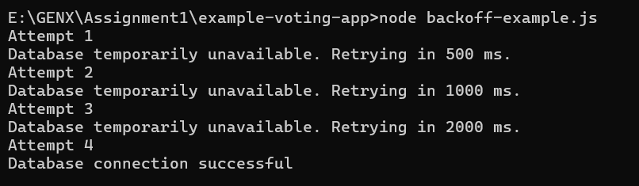

# Failure -Mode Notes - Vote Application
 
**Environment:** Local Docker Compose, run from VS Code on Windows  
**Scope:** Five manual failure simulations and recovery observations. No application-code changes were made as part of these simulations.

These notes record the terminal output, screenshots and browser observations collected during the exercise. They describe current behaviour, not completed reliability fixes. Existing container images were used with `--no-build`; a clean rebuild was not validated.

## Application flow

Vote accepts a submission and adds it to Redis. Worker reads the queued vote and saves it in PostgreSQL. Result queries PostgreSQL and sends totals to the browser. Queue acceptance and database persistence are separate steps.

## Failure matrix

| Failure | Detection / backend behaviour | User experience | Operator signal | Recovery observed |
|---|---|---|---|---|
| PostgreSQL unavailable at Result startup | Initial connection fails; Result stays running and retries. | “Results currently unavailable.” | Repeated `Waiting for db`. | After DB started, Result logged `Connected to db` and totals returned without a browser refresh or Result restart. |
| PostgreSQL responds slowly | A 15-second table lock delays the vote-count query and Worker writes. No explicit Result query timeout is configured. | Previous totals remain visible during the delay. | SQL output confirmed `LOCK TABLE`, `pg_sleep` and `ROLLBACK`. No application slow-query warning was captured. | After a vote was changed during the lock, results updated automatically, approximately after the delay ended. |
| PostgreSQL connection lost after startup | Result logs connection/query errors and stops its polling chain. Worker exits with code 1. | Results stay unavailable even after DB restarts. | `Connection terminated unexpectedly`; client `is not queryable`; Worker reports PostgreSQL error `57P01`. | Restarting DB alone did not restore results. Manually restarting Result and Worker restored the results page. |
| Redis unavailable | Vote cannot complete its Redis write. Worker stays running and retries Redis connections. | Submission loads for a long time, then shows a Flask technical error page. | `POST /` returns HTTP 500; Redis `ConnectionError`; Worker logs `Waiting for redis`. | After Redis returned, reopening/refreshing the voting page and submitting again updated results. No Vote or Worker restart was reported. |
| PostgreSQL returns a query error | DB stays running, but renaming `votes` makes Result's SELECT fail. Polling stops. | “Results currently unavailable,” including after the table name is restored. | `Error performing query: error: relation "votes" does not exist`. | After restoring the table, restarting Result and starting Worker restored the results page. |


## Fail-fast vs fail-safe

Fail-fast means stopping an operation promptly when it cannot succeed,
instead of continuing to wait or consuming more resources.

Fail-safe means handling failure in a way that protects correctness
and leaves the application in a safe state.

These approaches can work together: an operation can fail quickly
and still provide a safe response.

| Aspect | Fail-fast | Fail-safe |
|---|---|---|
| Main goal | Avoid unnecessary waiting and work. | Protect correctness when something fails. |
| Voting-app example | End a database query after a defined timeout. | Hide unverified results and show “Results currently unavailable.” |
| Redis example | End a failed submission within a bounded deadline. | Do not tell the user their vote was accepted unless queue acceptance is confirmed. |
| Main trade-off | A brief dependency problem may cause an operation to fail. | Some features become unavailable to avoid misleading behaviour. |

### What our tests showed

- During the slow-DB test, Result waited and continued showing previous
  totals. It did not fail fast or indicate that results were stale.
- After a DB connection or query error, Result hid numeric results and
  displayed an unavailable message. This protected users from treating
  those totals as current.
- During the Redis outage, submission waited and eventually returned
  HTTP 500 with a technical error page. This needs a clearer user-facing
  failure response.

### Expected approach

Use bounded waiting for dependency operations, then provide a clear
failure state. Never convert a database error into “zero votes,” and
never report successful vote acceptance when acceptance is uncertain.

A timeout should be selected from measured normal response times and
the application's requirements. No new timeout is implemented by
these notes.
## Graceful degradation

Graceful degradation means keeping useful parts of the application
available when a dependency fails.

Our Result service remains running after a detected database error
and displays “Results currently unavailable.” This prevents users
from treating previously received totals as current results.

The protection is incomplete: slow queries leave old totals visible
without a warning, and Redis failures expose a technical error page.

Vote and Redis can remain available during a PostgreSQL outage,
but queue acceptance does not prove that a vote reached the database.

## Retry design

Retries should be used for temporary failures and bounded by an
attempt limit and an overall time budget.

| Failure | Retry decision |
|---|---|
| Temporary connection failure | Retry with a timeout and backoff. |
| Database overload or timeout | Retry cautiously to avoid increasing the load. |
| Missing table, invalid SQL or invalid credentials | Stop unchanged retries and correct the cause. |
| Write with an uncertain outcome | Avoid blind retries because the first write may have succeeded. |

Result currently retries its initial connection up to 1,000 times,
with a one-second delay after each failed attempt. It does not
automatically reconnect after an established connection fails.

A retry policy should:
- Classify temporary and permanent errors.
- Bound individual operations and total retry duration.
- Increase delays between repeated failures.
- Stop on success, permanent failure, exhausted budget or shutdown.
- Avoid retries at multiple layers multiplying the work.
- Log exhaustion without exposing credentials.

Read-only vote queries can be repeated without duplicating votes.
Writes require an idempotency or deduplication strategy. A unique
voter ID alone does not prevent an old retried vote from overwriting
a newer choice.

## Exponential backoff

Exponential backoff increases the delay between retries, for example
500 ms, 1 second, 2 seconds and 4 seconds.

A maximum delay prevents unlimited growth. Jitter randomises the
delay so multiple clients do not retry simultaneously and overload
the recovering dependency.

The current Result service uses fixed-delay startup retries.

### Example implementation

The standalone example is in [backoff-example.js](backoff-example.js).
It simulates temporary database connection failures and demonstrates
increasing retry delays with a maximum attempt limit.



## Circuit breakers

A circuit breaker temporarily blocks calls to a repeatedly failing
dependency.

| State | Behaviour |
|---|---|
| Closed | Allow calls and monitor failures. |
| Open | Reject calls quickly during a cooldown period. |
| Half-open | Allow a limited trial operation to check recovery. |

A successful trial allows normal calls to resume. A failed trial
opens the circuit again.

For Result, this could mean pausing normal polling after repeated
database failures, showing unavailable results and allowing a
controlled recovery query later.

The benefit is reduced pressure on a failing dependency. The
trade-off is extra state and potentially delayed recovery.

The current application has no circuit breaker. Stopping polling
without a recovery path is not a complete circuit breaker.

## Bulkheads

Bulkheads isolate resources so one failing component cannot exhaust
resources needed by the rest of the application.

Separate Vote, Result and Worker containers provide some process
isolation. Worker exited during our DB connection-loss test while
Result remained running.

However, containers still share host resources and dependencies.
Stronger isolation could include:
- Bounded database connection pools and waiting requests.
- Limits on concurrent dependency operations.
- Container CPU and memory limits.
- Queue capacity limits and controlled rejection of excess work.

These protections limit the impact of failures but require capacity
planning. Separate containers alone do not guarantee isolation.

## Expected behaviour during database failure

This is the proposed behaviour, not a claim that every requirement
is already implemented.

| Situation | Expected behaviour | Verification |
|---|---|---|
| Healthy database | Display totals from successful queries. | Change a vote and confirm updated results. |
| DB unavailable at startup | Keep Result running, show unavailable and retry within a defined budget. | Start Result while DB is stopped. |
| Slow query | Enforce a query deadline and stop presenting outdated totals as current. | Hold a table lock beyond the configured deadline. |
| Connection lost | Mark results unavailable, stop normal polling and discard the unusable connection. | Stop DB after Result connects. |
| Permanent query error | Log the error and stop unchanged retries until the cause is corrected. | Temporarily rename the required table. |
| New browser during failure | Immediately communicate the unavailable state. | Open a fresh browser tab during the outage. |
| Dependency restored | Mark results available only after a successful vote-count query. | Restore the dependency and check current totals. |
| Retry budget exhausted | Remain unavailable and provide an operator-visible failure signal. | Keep DB unavailable until retries are exhausted. |

Never use zero votes as a fallback for a failed query.

Normal polling must stop on failure. Any future automatic recovery
should use a separate, controlled mechanism and resume polling only
after a successful query.

Connection deadlines, query deadlines, retry limits and recovery
targets need to be selected using measured normal response times.
The total retry budget must include operation time and retry delays.

For the current implementation, runtime connection loss and query
errors require manual Result recovery after the cause is corrected.

Operator logs should include timestamps, the affected service,
the failed operation and safe error details. They must not expose
credentials or sensitive data.


## 1. PostgreSQL unavailable at startup

**Simulation:** Stopped Result, Worker and DB, then started only Result with `--no-deps`. This bypassed Compose's DB health dependency so Result's own startup handling could be tested.

```bash
docker compose stop result worker db
docker compose up -d --no-deps result
```

**Partial functionality:** Vote and Redis remained running. Worker was deliberately stopped, so queued votes could not be processed. Successful vote persistence during the outage was not demonstrated.

**Retries:** Confirmed by repeated `Waiting for db`. The source permits up to 1,000 initial connection attempts with a 1-second delay after each failed attempt. Actual log intervals were about 5-9 seconds because attempts also took time. This is not exponential backoff or a 1,000-second overall deadline.

**Recovery:** Started DB only. The browser recovered automatically. Worker was subsequently started to restore processing.

**When to stop retrying:** Current startup retries stop on success or after 1,000 attempts. A future policy should bound elapsed time and distinguish temporary outages from permanent configuration errors. The exhaustion path was not tested.

## 2. PostgreSQL responds slowly

**Simulation:** Held an exclusive lock on `votes` for 15 seconds, then released it:

```bash
docker compose exec -T db psql -U postgres -d postgres -v ON_ERROR_STOP=1 -c "BEGIN; SET LOCAL lock_timeout = '5s'; LOCK TABLE votes IN ACCESS EXCLUSIVE MODE; SELECT pg_sleep(15); ROLLBACK;"
```

Changed the vote to the other option during the second run. Percentages updated automatically afterward. Changing an existing vote does not necessarily increase the total vote count.

**Partial functionality:** The voting page remained usable; reads and writes to the locked table were delayed. Existing results remained visible without a freshness warning.

**Retries:** This was a pending query completing after a delay, not a failed query being retried. Result schedules its next poll only after success.

**When to stop waiting/retrying:** Result currently has no explicit query deadline. A future timeout should bound the wait and mark results unavailable or stale; this exercise did not add one. The `lock_timeout` above applies only to the test session acquiring its lock, not to Result's query.

**Evidence limit:** Approximately 15-second recovery was reported from visual observation, not precisely measured. This models lock-induced latency, not a network timeout.

## 3. PostgreSQL connection lost after startup

**Simulation:** With results already updating, stopped only DB:

```bash
docker compose stop db
```

Result's container remained up, but its logs showed connection errors followed by a failed query. Worker exited with code 1. Starting DB again left results unavailable.

**Partial functionality:** Vote and Redis remained running, but Worker was no longer processing votes. Submission durability during this outage was not verified.

**Retries:** Result has no runtime reconnection loop. Its startup retry loop had already completed. Worker did not recover automatically in this run.

**When to stop retrying:** Do not reuse a broken connection. Any future reconnection policy should acquire a fresh connection with bounded retries. Current manual recovery was:

```bash
docker compose start db
# After PostgreSQL is available:
docker compose restart result worker
```

**Finding:** Process availability did not mean results were updating. Manual recovery restored the page; a separate fresh-vote persistence check was not explicitly confirmed for this case.

## 4. Redis unavailable

**Simulation:** Stopped Redis and attempted to change a vote:

```bash
docker compose stop redis
```

The request waited, then failed with HTTP 500. The screenshot showed `redis.exceptions.ConnectionError: Error -2 connecting to redis:6379. Name or service not known.` Worker continued logging connection attempts rather than exiting in this run.

**Partial functionality:** PostgreSQL and Result remained running. Vote's GET health check continued returning HTTP 200, although submissions were failing. The results page's appearance during the Redis outage was not explicitly confirmed.

**Retries:** Worker retried Redis connections. The Python traceback includes client retry handling, but the exact retry count was not measured. `Received vote` is logged before `rpush`, so it does not prove queue acceptance. Multiple submissions appear in the logs; an exact duration for one request cannot be reliably calculated from them.

**When to stop retrying:** User requests should have a bounded deadline and a clear failure response. Worker should avoid unbounded rapid retries. Any future automatic replay must account for whether a write might already have succeeded.

**Recovery:** Started Redis. The failed browser page did not recover itself. A fresh submission worked and appeared in results without a reported Vote or Worker restart. This proves new work could proceed; it does not prove every earlier failed/pending submission was recovered.

## 5. Backend dependency returns an error

**Simulation:** Stopped Worker, then temporarily renamed the table while PostgreSQL stayed running:

```bash
docker compose stop worker
docker compose exec -T db psql -U postgres -d postgres -v ON_ERROR_STOP=1 -c "SET lock_timeout = '5s'; ALTER TABLE votes RENAME TO votes_failure_test;"
```

Result logged `relation "votes" does not exist` at `2026-10-12T06:58:13.161440583Z`. This tests an error response from a reachable dependency. Worker was stopped deliberately to avoid concurrent writes or table recreation; this was not a Worker crash.

**Partial functionality:** Vote and Redis were not stopped. Persistence was interrupted by the test setup, and results were unavailable. New submission behaviour was not separately verified.

**Retries:** Result stopped polling after the query error. Restoring the table alone did not resume polling.

**When to stop retrying:** A missing-table error needs correction; repeatedly running the unchanged query will not repair the schema. After correction, recovery needs a new query attempt. Current recovery required restarting Result.

```bash
docker compose exec -T db psql -U postgres -d postgres -v ON_ERROR_STOP=1 -c "ALTER TABLE votes_failure_test RENAME TO votes;"
docker compose restart result
docker compose start worker
```

Existing rows were preserved by renaming the table back. The user confirmed results returned; a separate fresh-vote persistence check was not explicitly confirmed for this case.

## Findings and scope decision

- Startup DB retries worked, but runtime connection loss and query errors required manual Result recovery.
- Slow queries left previous totals visible without indicating that they were stale.
- Redis failure caused a long wait followed by a technical HTTP 500 page.
- A healthy container or successful GET check did not prove that vote submission and processing worked.
- No exact failure-detection/recovery targets, retry-exhaustion behaviour or vote-loss guarantees were validated.

## References

- https://aws.amazon.com/builders-library/timeouts-retries-and-backoff-with-jitter/
- https://learn.microsoft.com/en-us/azure/architecture/patterns/circuit-breaker
- https://learn.microsoft.com/en-us/azure/architecture/patterns/bulkhead


